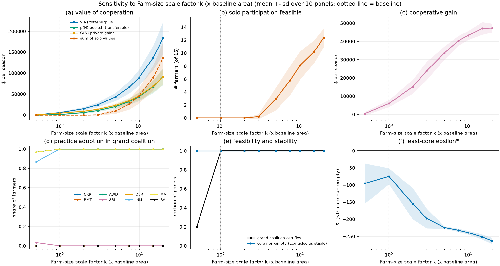

# Cooperative Game Theory for Smallholder Carbon Farming

[](https://github.com/SummmerKing/carbon-farming-cgt/actions/workflows/tests.yml)

Code for *A Cooperative Game Theoretic Approach to Sustainable, Smallholder Carbon Farming* (Game Theory Lab, IISc).

Carbon credits could pay smallholder farmers for adopting practices such as direct seeded rice, alternate wetting and drying or biochar, but monitoring, reporting and verification (MRV) and transaction costs are largely fixed, so a farm of under one hectare cannot pay for certification alone. This project models farmers who pool their land into a coalition that is certified together:

1. **Joint portfolio optimization.** For any coalition S, choose a practice portfolio for each member to maximize total economic surplus (carbon revenue plus private yield and cost effects, minus certification cost), subject to each farmer's budget and affordability constraints. The problem decomposes by farmer, so v(S) is computed exactly for all 2^15 coalitions in a fraction of a second.
2. **Sharing the pooled surplus.** Compare the Shapley value, the core (centroid and per-farmer range), the least core and the nucleolus against area-proportional and attributable-revenue baselines, and test each allocation for blocking coalitions.

## Key findings

On 10 benchmark panels of 15 farmers (exact, all coalitions):

- **No farmer can certify alone** at any carbon price under the baseline budget. Even with the budget limit removed, the median solo break-even price is about $432/tCO2e, against a baseline of $60.
- **The grand coalition certifies in every panel**, and its pooled carbon revenue covers certification from a median of about $44/tCO2e.
- **The core is non-empty in every run**, so the least core and the nucleolus are always stable. Area-proportional sharing becomes unstable when farmers' sequestration potential varies widely (at $150/tCO2e and high variation it is stable in only 10-50% of panels). The Shapley value holds up much better.



*Scaling every farm by a factor k: no farmer can certify alone until farms are about 3x the baseline size, while the coalition certifies at every scale from k = 1.*

All tables and figures are in [`results/SUMMARY.md`](results/SUMMARY.md).

## Layout

```
carbonfarm/
  config.py              baseline parameters (Table 1), seeds, paths
  data/                  practice tables (App. B.1-B.3), farmer panels (App. B.5), Instance
  model/                 portfolio enumeration, exact coalition solver (SPO / JPO / v(S)), MILP check
  game/                  Shapley, least core, nucleolus, core geometry, baselines, stability
  pipeline.py            analyze(instance) -> shares, payoffs, stability
experiments/
  run_baseline.py        one farmer panel, any n
  ablations/             a1 budget, a2 farm scale, a3 cost components, a4 MRV scaling,
                         a5 carbon price, a6 allocation comparison, a7 sequestration noise
  run_all.py             tests + all ablations + results/SUMMARY.md
  check_structure.py     superadditivity and convexity over all coalitions
tests/                   paper instances and solver tests on games with known answers
data/Dataset_USD/        practice tables as CSV
results/                 outputs of the runs in the paper
```

## Setup and usage

```bash
pip install -r requirements.txt
python -m pytest tests -q                       # a few seconds
python -m experiments.run_baseline              # panel 42, n = 15
python -m experiments.ablations.a1_budget       # a single ablation
python -m experiments.run_all                   # everything, writes results/SUMMARY.md
```

Gurobi is the default solver. Without a licence the code falls back to HiGHS (SciPy + CVXPY). The size-limited pip licence of Gurobi cannot hold the n = 15 least-core LPs (32,766 rows), so those models switch to HiGHS with a warning. Choose the solver with `--solver gurobi|highs|auto` or `CARBONFARM_SOLVER`. Ablations also take `--seeds k` (first k of the 10 panels), `--jobs` and `--plot-only`.

For more than 16 farmers the code samples coalitions (always keeping every singleton and co-singleton) and estimates Shapley values with antithetic Monte Carlo:

```bash
python -m experiments.run_baseline --n 250 --mc-sets 15000 --mc-perms 1250
```

## Ablations

| # | Script | Varied | Outputs |
|---|---|---|---|
| 1 | `a1_budget` | budget per ha, 0 to 1000 $/ha | solo feasibility, v(N), p(N), G(N), adoption, stability |
| 2 | `a2_farm_scale` | farm areas ×0.5 to ×20 | same |
| 3 | `a3_cost_components` | fixed/variable MRV and transaction costs | same |
| 4 | `a4_mrv_scaling` | MRV exponent delta; n = 5 to 1000 farmers | same, plus per-farmer value and cost per ha |
| 5 | `a5_carbon_price` | carbon price 10 to 500 $/tCO2e | same, plus break-even prices |
| 6 | `a6_allocation_comparison` | baseline, 10 panels | per-farmer shares and payoffs, stability, L1 distances, equity, core ranges |
| 7 | `a7_cmp_noise` | farmer-specific sequestration noise | when each sharing rule becomes unstable |
