# Results summary

All numbers are means over the benchmark panels (n = 15 farmers, exact). Dollar values are per season. See each figure for +-1 sd bands.

## Ablation 1 - budget ($/ha)
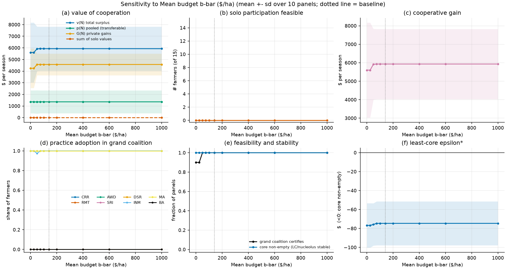

| budget_per_ha | avg size (ha) | solo-feasible (of 15) | sum v({i}) | v(N) | dv = v(N) - sum v({i}) | p(N) | grand feasible | core non-empty |
|---|---|---|---|---|---|---|---|---|
| 0 | 0.67 | 0.00 | 0.00 | 5,600.27 | 5,600.27 | 1,356.30 | 0.90 | 1.00 |
| 25 | 0.67 | 0.00 | 0.00 | 5,600.27 | 5,600.27 | 1,356.30 | 0.90 | 1.00 |
| 50 | 0.67 | 0.00 | 0.00 | 5,918.11 | 5,918.11 | 1,345.31 | 1.00 | 1.00 |
| 75 | 0.67 | 0.00 | 0.00 | 5,929.39 | 5,929.39 | 1,357.98 | 1.00 | 1.00 |
| 100 | 0.67 | 0.00 | 0.00 | 5,929.39 | 5,929.39 | 1,357.98 | 1.00 | 1.00 |
| 140 | 0.67 | 0.00 | 0.00 | 5,929.39 | 5,929.39 | 1,357.98 | 1.00 | 1.00 |
| 200 | 0.67 | 0.00 | 0.00 | 5,929.39 | 5,929.39 | 1,357.98 | 1.00 | 1.00 |
| 400 | 0.67 | 0.00 | 0.00 | 5,929.39 | 5,929.39 | 1,357.98 | 1.00 | 1.00 |
| 600 | 0.67 | 0.00 | 0.00 | 5,929.39 | 5,929.39 | 1,357.98 | 1.00 | 1.00 |
| 1000 | 0.67 | 0.00 | 0.00 | 5,929.39 | 5,929.39 | 1,357.98 | 1.00 | 1.00 |

## Ablation 2 - farm-size scale k
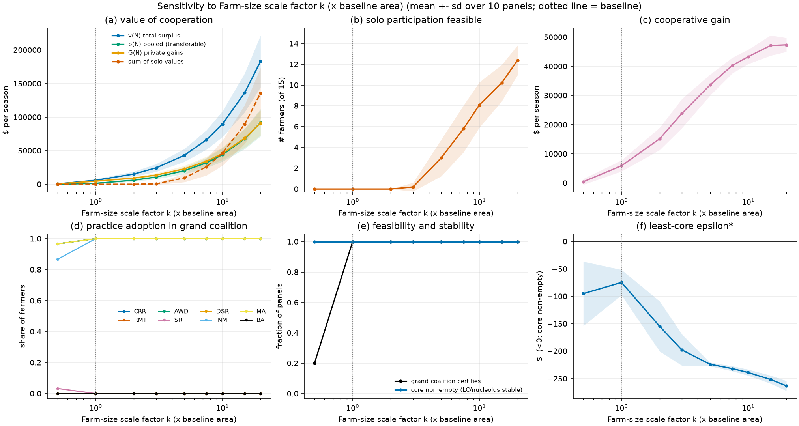

| scale | avg size (ha) | solo-feasible (of 15) | sum v({i}) | v(N) | dv = v(N) - sum v({i}) | p(N) | grand feasible | core non-empty |
|---|---|---|---|---|---|---|---|---|
| 0.50 | 0.34 | 0.00 | 0.00 | 470.57 | 470.57 | -110.80 | 0.20 | 1.00 |
| 1.00 | 0.67 | 0.00 | 0.00 | 5,929.39 | 5,929.39 | 1,357.98 | 1.00 | 1.00 |
| 2.00 | 1.34 | 0.00 | 0.00 | 15,159.29 | 15,159.29 | 6,016.46 | 1.00 | 1.00 |
| 3.00 | 2.01 | 0.20 | 542.47 | 24,425.81 | 23,883.34 | 10,711.56 | 1.00 | 1.00 |
| 5.00 | 3.35 | 3.00 | 9,388.50 | 43,014.48 | 33,625.98 | 20,157.40 | 1.00 | 1.00 |
| 7.50 | 5.03 | 5.80 | 25,977.64 | 66,309.17 | 40,331.53 | 32,023.54 | 1.00 | 1.00 |
| 10.00 | 6.70 | 8.10 | 46,353.47 | 89,643.30 | 43,289.84 | 43,929.14 | 1.00 | 1.00 |
| 15.00 | 10.05 | 10.20 | 89,247.89 | 136,385.08 | 47,137.19 | 67,813.83 | 1.00 | 1.00 |
| 20.00 | 13.40 | 12.40 | 135,821.61 | 183,190.93 | 47,369.33 | 91,762.60 | 1.00 | 1.00 |

## Ablation 3a - fixed MRV ($)
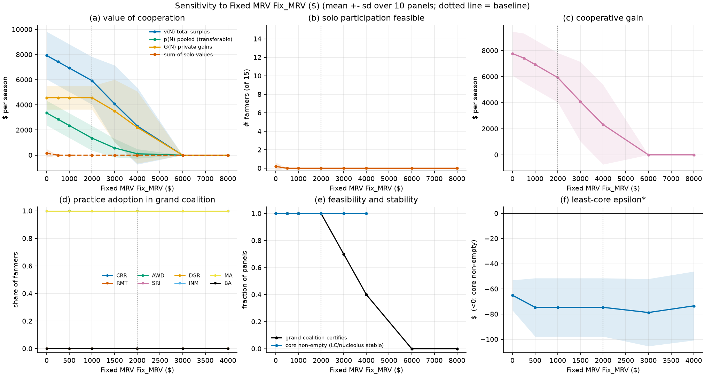

| fix_mrv | avg size (ha) | solo-feasible (of 15) | sum v({i}) | v(N) | dv = v(N) - sum v({i}) | p(N) | grand feasible | core non-empty |
|---|---|---|---|---|---|---|---|---|
| 0 | 0.67 | 0.20 | 154.60 | 7,929.39 | 7,774.80 | 3,357.98 | 1.00 | 1.00 |
| 500 | 0.67 | 0.00 | 0.00 | 7,429.39 | 7,429.39 | 2,857.98 | 1.00 | 1.00 |
| 1000 | 0.67 | 0.00 | 0.00 | 6,929.39 | 6,929.39 | 2,357.98 | 1.00 | 1.00 |
| 2000 | 0.67 | 0.00 | 0.00 | 5,929.39 | 5,929.39 | 1,357.98 | 1.00 | 1.00 |
| 3000 | 0.67 | 0.00 | 0.00 | 4,086.33 | 4,086.33 | 572.72 | 0.70 | 1.00 |
| 4000 | 0.67 | 0.00 | 0.00 | 2,321.33 | 2,321.33 | 111.57 | 0.40 | 1.00 |
| 6000 | 0.67 | 0.00 | 0.00 | 0.00 | 0.00 | 0.00 | 0.00 |  |
| 8000 | 0.67 | 0.00 | 0.00 | 0.00 | 0.00 | 0.00 | 0.00 |  |

## Ablation 3b - variable MRV ($/ha^delta)
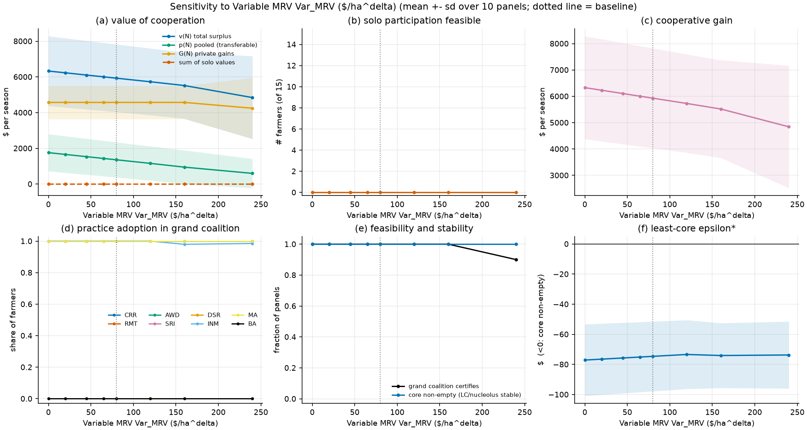

| var_mrv | avg size (ha) | solo-feasible (of 15) | sum v({i}) | v(N) | dv = v(N) - sum v({i}) | p(N) | grand feasible | core non-empty |
|---|---|---|---|---|---|---|---|---|
| 0 | 0.67 | 0.00 | 0.00 | 6,330.22 | 6,330.22 | 1,758.80 | 1.00 | 1.00 |
| 20 | 0.67 | 0.00 | 0.00 | 6,230.01 | 6,230.01 | 1,658.60 | 1.00 | 1.00 |
| 45 | 0.67 | 0.00 | 0.00 | 6,104.75 | 6,104.75 | 1,533.34 | 1.00 | 1.00 |
| 65 | 0.67 | 0.00 | 0.00 | 6,004.55 | 6,004.55 | 1,433.13 | 1.00 | 1.00 |
| 80 | 0.67 | 0.00 | 0.00 | 5,929.39 | 5,929.39 | 1,357.98 | 1.00 | 1.00 |
| 120 | 0.67 | 0.00 | 0.00 | 5,728.98 | 5,728.98 | 1,157.56 | 1.00 | 1.00 |
| 160 | 0.67 | 0.00 | 0.00 | 5,518.81 | 5,518.81 | 946.44 | 1.00 | 1.00 |
| 240 | 0.67 | 0.00 | 0.00 | 4,843.66 | 4,843.66 | 597.97 | 0.90 | 1.00 |

## Ablation 3c - fixed transaction ($)
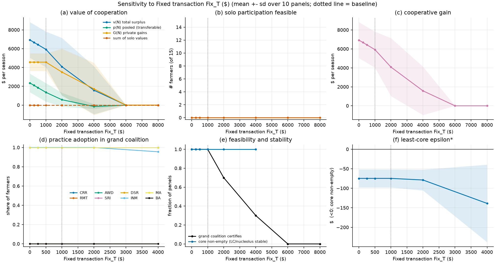

| fix_t | avg size (ha) | solo-feasible (of 15) | sum v({i}) | v(N) | dv = v(N) - sum v({i}) | p(N) | grand feasible | core non-empty |
|---|---|---|---|---|---|---|---|---|
| 0 | 0.67 | 0.00 | 0.00 | 6,929.39 | 6,929.39 | 2,357.98 | 1.00 | 1.00 |
| 250 | 0.67 | 0.00 | 0.00 | 6,679.39 | 6,679.39 | 2,107.98 | 1.00 | 1.00 |
| 500 | 0.67 | 0.00 | 0.00 | 6,429.39 | 6,429.39 | 1,857.98 | 1.00 | 1.00 |
| 1000 | 0.67 | 0.00 | 0.00 | 5,929.39 | 5,929.39 | 1,357.98 | 1.00 | 1.00 |
| 2000 | 0.67 | 0.00 | 0.00 | 4,086.33 | 4,086.33 | 572.72 | 0.70 | 1.00 |
| 4000 | 0.67 | 0.00 | 0.00 | 1,580.11 | 1,580.11 | -144.17 | 0.30 | 1.00 |
| 6000 | 0.67 | 0.00 | 0.00 | 0.00 | 0.00 | 0.00 | 0.00 |  |
| 8000 | 0.67 | 0.00 | 0.00 | 0.00 | 0.00 | 0.00 | 0.00 |  |

## Ablation 3d - variable transaction ($/farmer)
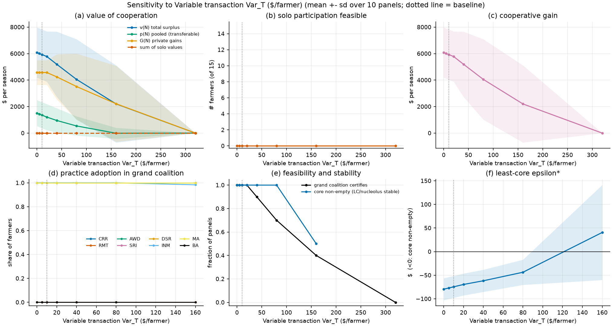

| var_t | avg size (ha) | solo-feasible (of 15) | sum v({i}) | v(N) | dv = v(N) - sum v({i}) | p(N) | grand feasible | core non-empty |
|---|---|---|---|---|---|---|---|---|
| 0 | 0.67 | 0.00 | 0.00 | 6,079.39 | 6,079.39 | 1,507.98 | 1.00 | 1.00 |
| 5 | 0.67 | 0.00 | 0.00 | 6,004.39 | 6,004.39 | 1,432.98 | 1.00 | 1.00 |
| 10 | 0.67 | 0.00 | 0.00 | 5,929.39 | 5,929.39 | 1,357.98 | 1.00 | 1.00 |
| 20 | 0.67 | 0.00 | 0.00 | 5,779.39 | 5,779.39 | 1,207.98 | 1.00 | 1.00 |
| 40 | 0.67 | 0.00 | 0.00 | 5,195.27 | 5,195.27 | 951.30 | 0.90 | 1.00 |
| 80 | 0.67 | 0.00 | 0.00 | 4,051.33 | 4,051.33 | 537.72 | 0.70 | 1.00 |
| 160 | 0.67 | 0.00 | 0.00 | 2,198.91 | 2,198.91 | -13.07 | 0.40 | 0.50 |
| 320 | 0.67 | 0.00 | 0.00 | 0.00 | 0.00 | 0.00 | 0.00 |  |

## Ablation 4 - MRV scale exponent delta
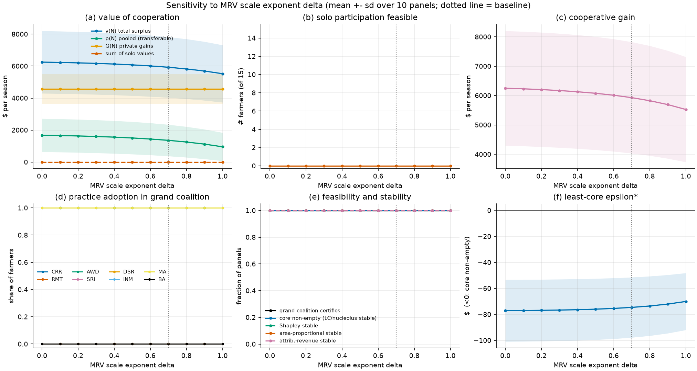

| delta | avg size (ha) | solo-feasible (of 15) | sum v({i}) | v(N) | dv = v(N) - sum v({i}) | p(N) | grand feasible | core non-empty | Shapley stable |
|---|---|---|---|---|---|---|---|---|---|
| 0.00 | 0.67 | 0.00 | 0.00 | 6,250.22 | 6,250.22 | 1,678.80 | 1.00 | 1.00 | 1.00 |
| 0.10 | 0.67 | 0.00 | 0.00 | 6,229.62 | 6,229.62 | 1,658.21 | 1.00 | 1.00 | 1.00 |
| 0.20 | 0.67 | 0.00 | 0.00 | 6,203.68 | 6,203.68 | 1,632.26 | 1.00 | 1.00 | 1.00 |
| 0.30 | 0.67 | 0.00 | 0.00 | 6,170.98 | 6,170.98 | 1,599.56 | 1.00 | 1.00 | 1.00 |
| 0.40 | 0.67 | 0.00 | 0.00 | 6,129.76 | 6,129.76 | 1,558.34 | 1.00 | 1.00 | 1.00 |
| 0.50 | 0.67 | 0.00 | 0.00 | 6,077.77 | 6,077.77 | 1,506.35 | 1.00 | 1.00 | 1.00 |
| 0.60 | 0.67 | 0.00 | 0.00 | 6,012.18 | 6,012.18 | 1,440.76 | 1.00 | 1.00 | 1.00 |
| 0.70 | 0.67 | 0.00 | 0.00 | 5,929.39 | 5,929.39 | 1,357.98 | 1.00 | 1.00 | 1.00 |
| 0.80 | 0.67 | 0.00 | 0.00 | 5,824.87 | 5,824.87 | 1,253.46 | 1.00 | 1.00 | 1.00 |
| 0.90 | 0.67 | 0.00 | 0.00 | 5,692.86 | 5,692.86 | 1,121.44 | 1.00 | 1.00 | 1.00 |
| 1.00 | 0.67 | 0.00 | 0.00 | 5,526.06 | 5,526.06 | 954.64 | 1.00 | 1.00 | 1.00 |

## Ablation 5 - carbon credit price ($/tCO2e)
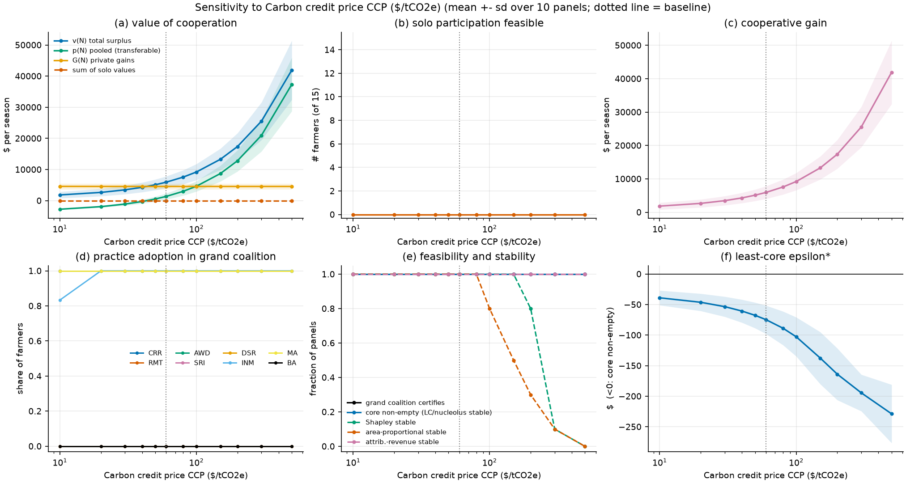

| ccp | avg size (ha) | solo-feasible (of 15) | sum v({i}) | v(N) | dv = v(N) - sum v({i}) | p(N) | grand feasible | core non-empty | Shapley stable |
|---|---|---|---|---|---|---|---|---|---|
| 10 | 0.67 | 0.00 | 0.00 | 1,841.54 | 1,841.54 | -2,749.72 | 1.00 | 1.00 | 1.00 |
| 20 | 0.67 | 0.00 | 0.00 | 2,656.86 | 2,656.86 | -1,914.56 | 1.00 | 1.00 | 1.00 |
| 30 | 0.67 | 0.00 | 0.00 | 3,474.99 | 3,474.99 | -1,096.42 | 1.00 | 1.00 | 1.00 |
| 40 | 0.67 | 0.00 | 0.00 | 4,293.13 | 4,293.13 | -278.29 | 1.00 | 1.00 | 1.00 |
| 50 | 0.67 | 0.00 | 0.00 | 5,111.26 | 5,111.26 | 539.84 | 1.00 | 1.00 | 1.00 |
| 60 | 0.67 | 0.00 | 0.00 | 5,929.39 | 5,929.39 | 1,357.98 | 1.00 | 1.00 | 1.00 |
| 80 | 0.67 | 0.00 | 0.00 | 7,565.66 | 7,565.66 | 2,994.24 | 1.00 | 1.00 | 1.00 |
| 100 | 0.67 | 0.00 | 0.00 | 9,201.93 | 9,201.93 | 4,630.51 | 1.00 | 1.00 | 1.00 |
| 150 | 0.67 | 0.00 | 0.00 | 13,292.60 | 13,292.60 | 8,721.18 | 1.00 | 1.00 | 1.00 |
| 200 | 0.67 | 0.00 | 0.00 | 17,383.27 | 17,383.27 | 12,811.85 | 1.00 | 1.00 | 0.80 |
| 300 | 0.67 | 0.00 | 0.00 | 25,564.60 | 25,564.60 | 20,993.19 | 1.00 | 1.00 | 0.10 |
| 500 | 0.67 | 0.00 | 0.00 | 41,927.28 | 41,927.28 | 37,355.86 | 1.00 | 1.00 | 0.00 |

## Ablation 4b - population scaling (number of farmers)
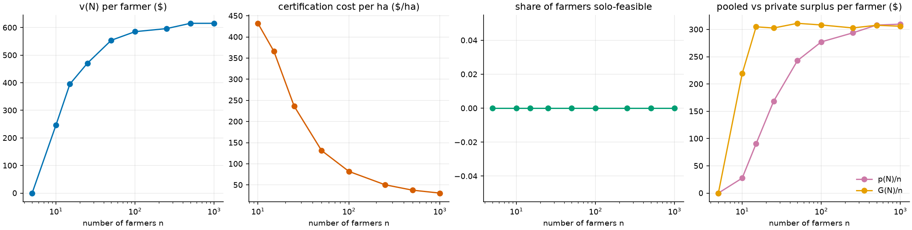

| n_req | solo_feasible | v_N | p_N | G_N | cert_cost_per_ha |
|---|---|---|---|---|---|
| 5 | 0.00 | 0.00 | 0.00 | 0.00 |  |
| 10 | 0.00 | 2,463.86 | 274.11 | 2,189.75 | 432.19 |
| 15 | 0.00 | 5,929.39 | 1,357.98 | 4,571.42 | 365.79 |
| 25 | 0.00 | 11,775.32 | 4,210.11 | 7,565.21 | 236.47 |
| 50 | 0.00 | 27,702.25 | 12,142.97 | 15,559.28 | 131.47 |
| 100 | 0.00 | 58,533.30 | 27,714.90 | 30,818.41 | 81.94 |
| 250 | 0.00 | 149,095.27 | 73,416.77 | 75,678.50 | 50.34 |
| 500 | 0.00 | 307,757.87 | 153,957.35 | 153,800.52 | 37.60 |
| 1000 | 0.00 | 615,553.22 | 309,688.06 | 305,865.16 | 30.68 |

## Ablation 5b - break-even carbon prices ($/tCO2e)
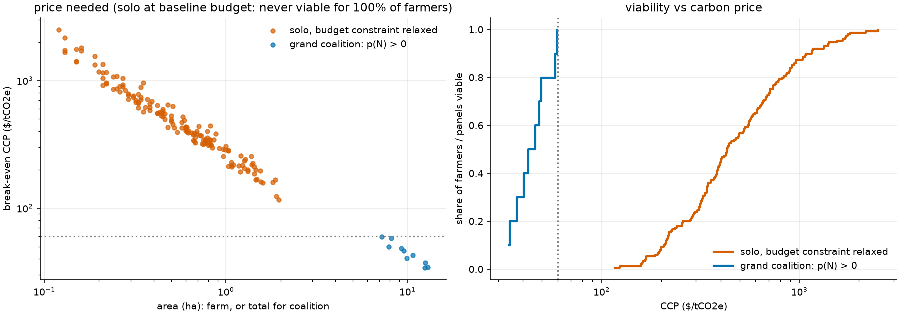

| who | median | min | max | never |
|---|---|---|---|---|
| grand_certifies | 0.00 | 0.00 | 3.19 | 0.00 |
| grand_pool_pos | 44.47 | 34.16 | 59.71 | 0.00 |
| solo | inf | inf | inf | 100.00 |
| solo_no_budget | 431.61 | 116.35 | 2,506.24 | 0.00 |

## Ablation 6 - allocation comparison at the baseline
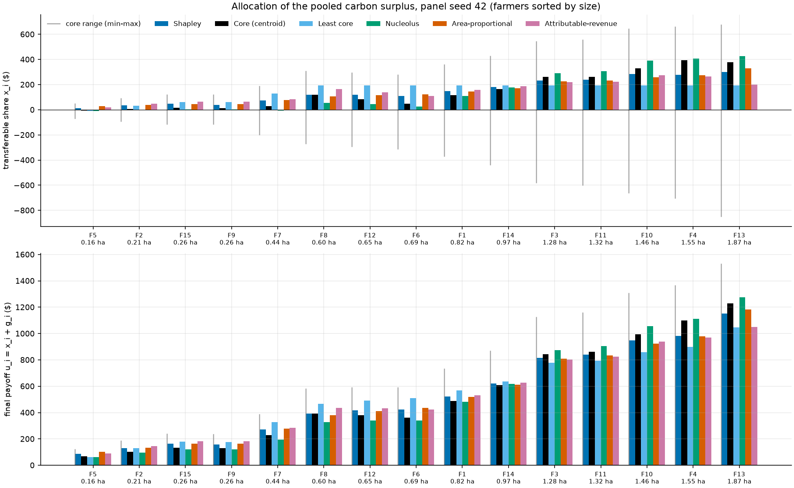

### Final payoffs u_i = x_i + g_i, panel seed 42 (Table 6 analogue)
| Size (ha) | Avg CMP | Shapley | Core (centroid) | Least core | Nucleolus | Area-proportional | Attributable-revenue |
|---|---|---|---|---|---|---|---|
| 0.16 | 1.77 | 86.75 | 66.86 | 61.47 | 61.47 | 101.10 | 90.95 |
| 0.21 | 1.78 | 130.37 | 101.40 | 128.83 | 95.15 | 132.69 | 145.20 |
| 0.26 | 1.88 | 165.15 | 134.06 | 179.66 | 120.56 | 164.28 | 182.91 |
| 0.26 | 2.03 | 156.40 | 130.91 | 177.90 | 119.68 | 164.28 | 181.15 |
| 0.44 | 1.90 | 272.67 | 229.46 | 328.14 | 194.80 | 278.01 | 284.19 |
| 0.60 | 1.97 | 391.38 | 393.11 | 467.80 | 329.17 | 379.11 | 436.27 |
| 0.65 | 2.00 | 415.68 | 380.49 | 490.54 | 339.14 | 410.70 | 433.13 |
| 0.69 | 1.76 | 424.37 | 361.52 | 508.73 | 340.04 | 435.98 | 423.56 |
| 0.82 | 1.71 | 522.09 | 488.75 | 567.85 | 482.04 | 518.12 | 531.50 |
| 0.97 | 1.93 | 621.31 | 607.20 | 636.07 | 617.65 | 612.89 | 627.84 |
| 1.28 | 1.73 | 813.95 | 844.23 | 777.05 | 873.61 | 808.77 | 802.67 |
| 1.32 | 1.95 | 840.63 | 861.37 | 795.24 | 905.90 | 834.04 | 824.51 |
| 1.46 | 1.71 | 948.35 | 993.08 | 858.91 | 1,055.55 | 922.50 | 937.54 |
| 1.55 | 1.68 | 983.51 | 1,100.80 | 899.84 | 1,112.23 | 979.37 | 970.69 |
| 1.87 | 1.78 | 1,150.78 | 1,230.14 | 1,045.37 | 1,276.41 | 1,181.56 | 1,051.27 |

### Stability (Table 7 analogue, mean over panels)
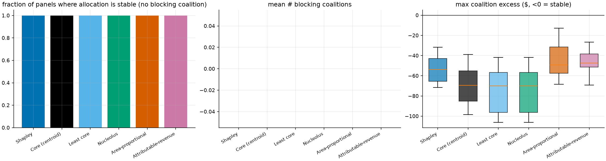

| mechanism | frac_stable | mean_violations | mean_max_excess | mean_ir_violations | mean_min_gain_over_solo | n_panels |
|---|---|---|---|---|---|---|
| Shapley | 1.00 | 0.00 | -53.59 | 0.00 | 85.47 | 10 |
| Core (centroid) | 1.00 | 0.00 | -70.24 | 0.00 | 78.55 | 10 |
| Least core | 1.00 | 0.00 | -74.62 | 0.00 | 74.62 | 10 |
| Nucleolus | 1.00 | 0.00 | -74.62 | 0.00 | 74.62 | 10 |
| Area-proportional | 1.00 | 0.00 | -43.94 | 0.00 | 101.76 | 10 |
| Attributable-revenue | 1.00 | 0.00 | -47.11 | 0.00 | 100.52 | 10 |

### Mean L1 distance between allocations, % of p(F)
|  | shapley | core | least_core | nucleolus | area_proportional | attributable_revenue |
|---|---|---|---|---|---|---|
| shapley | 0.0 | 224.1 | 324.3 | 385.8 | 299.0 | 425.8 |
| core | 224.1 | 0.0 | 329.7 | 310.9 | 305.8 | 385.9 |
| least_core | 324.3 | 329.7 | 0.0 | 226.3 | 42.3 | 290.4 |
| nucleolus | 385.8 | 310.9 | 226.3 | 0.0 | 205.9 | 260.6 |
| area_proportional | 299.0 | 305.8 | 42.3 | 205.9 | 0.0 | 278.2 |
| attributable_revenue | 425.8 | 385.9 | 290.4 | 260.6 | 278.2 | 0.0 |

### Equity indicators
| mechanism | gini_u | corr_x_farm_size | corr_x_cmp | share_of_pF_to_smaller_half | cv_payoff_per_ha |
|---|---|---|---|---|---|
| Shapley | 0.347 | 0.882 | 0.101 | -0.360 | 0.084 |
| Core (centroid) | 0.385 | 0.882 | 0.114 | -0.656 | 0.150 |
| Least core | 0.309 | 0.622 | 0.032 | 0.385 | 0.121 |
| Nucleolus | 0.407 | 0.828 | 0.148 | -0.187 | 0.198 |
| Area-proportional | 0.326 | 1.000 | -0.004 | 0.293 | 0.000 |
| Attributable-revenue | 0.333 | 0.620 | 0.397 | 0.564 | 0.110 |

## Ablation 7 - instability vs CMP noise (and carbon price)
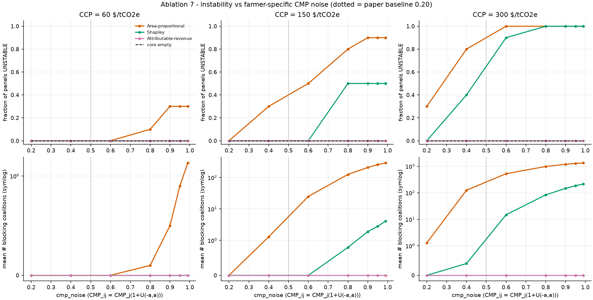
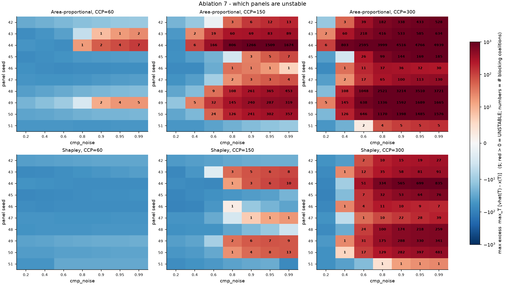

Means over the panels. Core / least core / nucleolus stayed non-empty in every run. Per-panel unstable cells: `results/ablations/a7_cmp_noise/unstable.csv`; worst blocking coalition per unstable panel: `blockers.csv`.

| CCP | cmp_noise | # blocking area proportional | frac stable area proportional | # blocking shapley | frac stable shapley | # blocking attributable revenue |
|---|---|---|---|---|---|---|
| 60 | 0.20 | 0.00 | 1.00 | 0.00 | 1.00 | 0.00 |
| 60 | 0.40 | 0.00 | 1.00 | 0.00 | 1.00 | 0.00 |
| 60 | 0.60 | 0.00 | 1.00 | 0.00 | 1.00 | 0.00 |
| 60 | 0.80 | 0.10 | 0.90 | 0.00 | 1.00 | 0.00 |
| 60 | 0.90 | 0.50 | 0.70 | 0.00 | 1.00 | 0.00 |
| 60 | 0.95 | 0.90 | 0.70 | 0.00 | 1.00 | 0.00 |
| 60 | 0.99 | 1.40 | 0.70 | 0.00 | 1.00 | 0.00 |
| 150 | 0.20 | 0.00 | 1.00 | 0.00 | 1.00 | 0.00 |
| 150 | 0.40 | 1.30 | 0.70 | 0.00 | 1.00 | 0.00 |
| 150 | 0.60 | 25.00 | 0.50 | 0.00 | 1.00 | 0.00 |
| 150 | 0.80 | 125.10 | 0.20 | 0.80 | 0.50 | 0.00 |
| 150 | 0.90 | 209.00 | 0.10 | 1.90 | 0.50 | 0.00 |
| 150 | 0.95 | 256.70 | 0.10 | 2.80 | 0.50 | 0.00 |
| 150 | 0.99 | 291.70 | 0.10 | 4.10 | 0.50 | 0.00 |
| 300 | 0.20 | 1.30 | 0.70 | 0.00 | 1.00 | 0.00 |
| 300 | 0.40 | 124.80 | 0.20 | 0.40 | 0.60 | 0.00 |
| 300 | 0.60 | 524.00 | 0.00 | 14.90 | 0.10 | 0.00 |
| 300 | 0.80 | 982.90 | 0.00 | 83.70 | 0.00 | 0.00 |
| 300 | 0.90 | 1,187.60 | 0.00 | 146.80 | 0.00 | 0.00 |
| 300 | 0.95 | 1,278.70 | 0.00 | 184.60 | 0.00 | 0.00 |
| 300 | 0.99 | 1,341.30 | 0.00 | 215.70 | 0.00 | 0.00 |

### Control - budget noise (sd = clip) at cmp_noise 0.95
| budget_noise_sd | viol_shapley | viol_area_proportional | eps_star | v_N |
|---|---|---|---|---|
| 0.00 | 2.10 | 262.90 | -130.99 | 13,251.76 |
| 0.20 | 2.50 | 261.70 | -130.99 | 13,251.76 |
| 0.50 | 2.80 | 256.70 | -130.99 | 13,251.76 |
| 0.80 | 4.30 | 216.90 | -149.81 | 13,263.46 |
| 0.95 | 6.11 | 146.00 | -137.44 | 12,477.55 |
